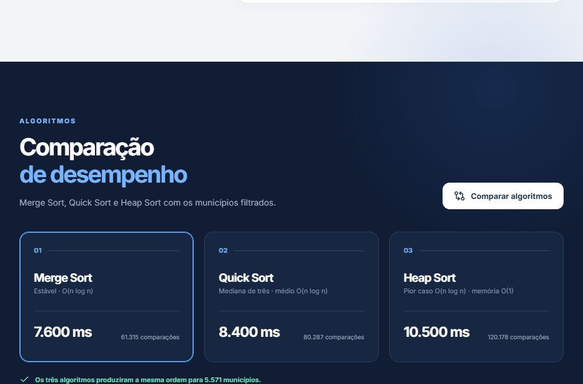
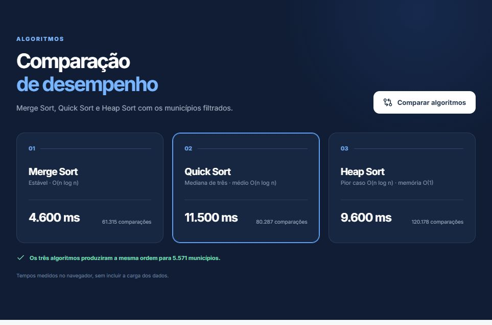
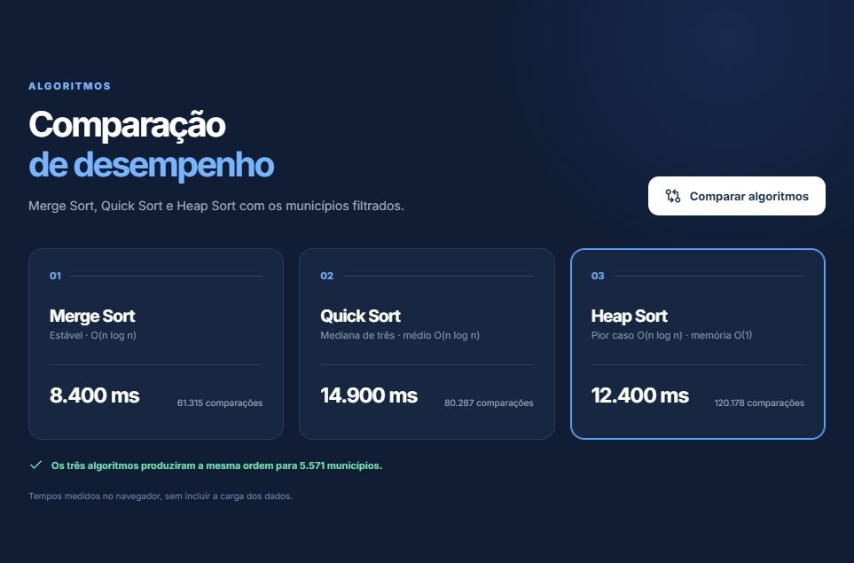

# Atlas do Voto 2026

Número da Lista: Grupo 38<br>
Conteúdo da Disciplina: Algoritmos de Ordenação<br>

## Aluno

| Matrícula | Aluno | GitHub |
| -- | -- | -- |
| 221007985 | Diassis Bezerra Nascimento | [@diaxiz](https://github.com/diaxiz) |

## Sobre

O Atlas do Voto mostra os resultados do primeiro turno da eleição presidencial de 2026 por município. É possível escolher uma candidatura, filtrar por estado ou município e ordenar os resultados por votos, participação percentual ou nome.

O ranking pode usar três algoritmos implementados em TypeScript:

- **Merge Sort**: divide a lista e combina as partes ordenadas.
- **Quick Sort**: particiona a lista em torno de um pivô.
- **Heap Sort**: organiza os registros em uma heap antes de ordená-los.

A interface exibe o número de comparações e permite medir os três algoritmos sobre os mesmos municípios.

## Fonte dos Dados

Os dados vêm do [Portal de Dados Abertos do TSE](https://dadosabertos.tse.jus.br/):

- [Resultados de 2026](https://dadosabertos.tse.jus.br/dataset/resultados-2026): votos por seção eleitoral.
- [Candidatos de 2026](https://dadosabertos.tse.jus.br/pt_BR/dataset/candidatos-2026): siglas partidárias e fotos das candidaturas presidenciais. As fotos têm licença Creative Commons Atribuição.

O importador agrega os votos por candidatura e município. O arquivo usado na interface está em `public/data/municipios-2026.json`.

## Algoritmos Implementados

| Algoritmo | Uso no projeto | Complexidade |
| -- | -- | -- |
| Merge Sort | Ordenação por divisão e intercalação | O(n log n) |
| Quick Sort | Ordenação por particionamento | O(n log n) médio; O(n²) pior caso |
| Heap Sort | Ordenação com heap | O(n log n) |

Onde `n` é o número de municípios após os filtros. A ordem crescente ou decrescente muda o comparador, não o algoritmo selecionado.

## Screenshots

### Merge Sort



### Quick Sort



### Heap Sort



## Estrutura do Projeto

```text
G38_Ordenacao_EDA2-2026.2/
├── public/
│   ├── candidates/          # Fotos do TSE
│   └── data/municipios-2026.json
├── scripts/import-tse.mjs
├── src/
│   ├── App.tsx
│   ├── styles.css
│   └── lib/
│       ├── candidateVisuals.ts
│       └── sort.ts
├── tests/sort.test.ts
├── package.json
└── README.md
```

## Instalação

Linguagem: TypeScript<br>
Interface: React e Vite<br>

Pré-requisitos:

- Node.js 20.19+ ou 22.12+.
- npm.

Instale as dependências:

```bash
npm install
```

## Preparação da Base

O JSON processado já acompanha o projeto. Para refazer a importação com o arquivo do TSE:

```bash
npm run data:import
```

O ZIP fica em `.cache/` e é reutilizado nas próximas execuções. Para baixar uma versão atualizada:

```bash
npm run data:import -- --refresh
```

## Uso

Inicie a aplicação:

```bash
npm run dev
```

Na interface, escolha candidatura, estado, critério, ordem e algoritmo. A busca filtra municípios pelo nome. O botão **Comparar algoritmos** executa os três métodos sobre a seleção atual. O ranking pode ser exportado em CSV.

## Testes

```bash
npm test
npm run build
```

## Observações

- O recorte exclui votos no exterior (UF `ZZ`).
- Participação = votos da candidatura ÷ votos nominais do município; brancos e nulos ficam fora.
- Empates numéricos são resolvidos por nome, UF e código TSE.
- Os tempos são medidos no navegador e variam conforme o dispositivo.
- As cores dos partidos na interface são aproximações de suas identidades visuais.

## Vídeo

Ainda não disponível.
